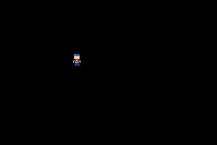

# StarTrak

A Game Boy Advance game I made with C++ and Butano. You control a little knight, and you can add dots that circle around him.

**[Play it here](https://alexandrbalan.github.io/orbits/)**

## Controls

| Button | Keyboard | What it does |
|--------|----------|--------------|
| D-pad | Arrow keys | Move the knight |
| A | X | Add a dot |
| B | Z | Remove the last dot |
| Start | Enter | Remove all dots |